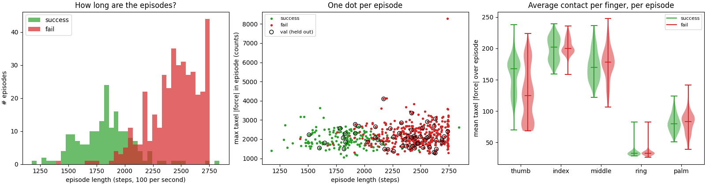
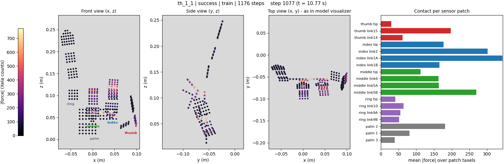
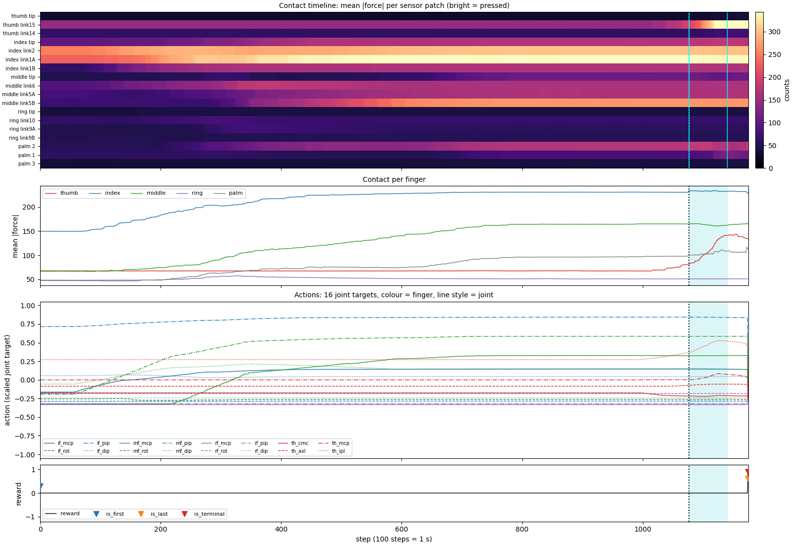
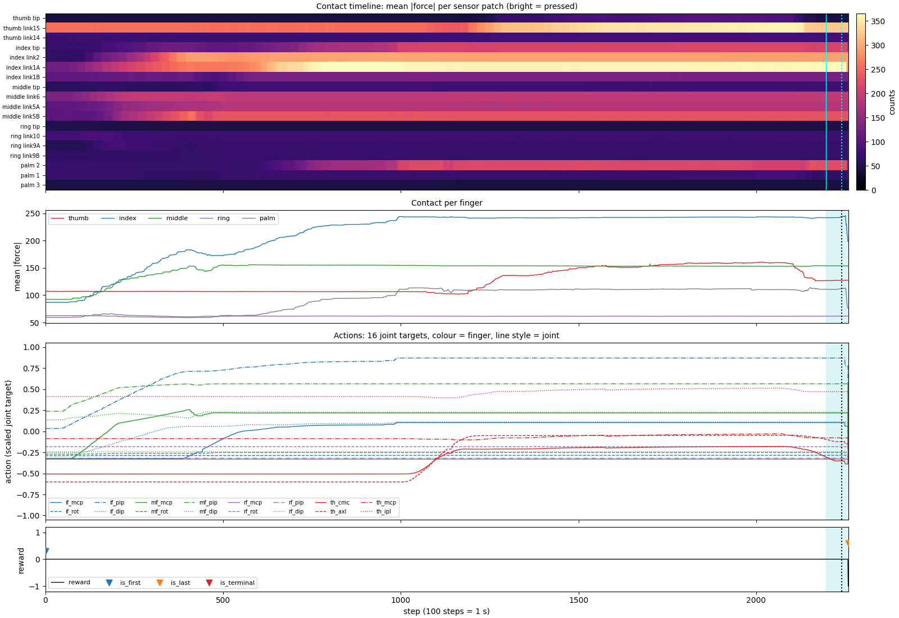
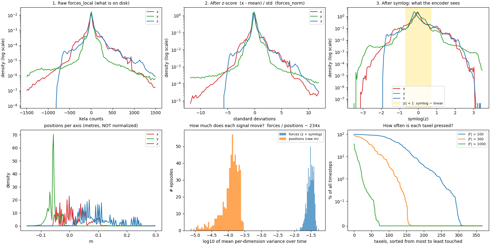
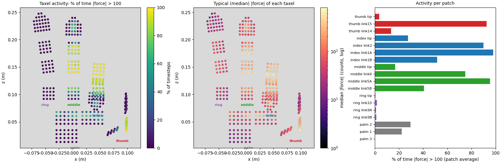
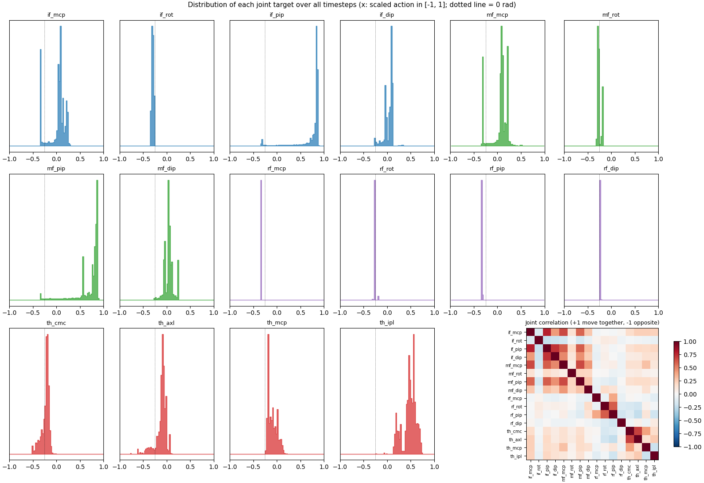
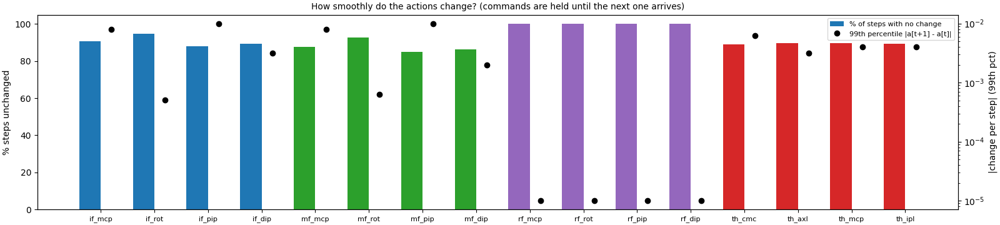
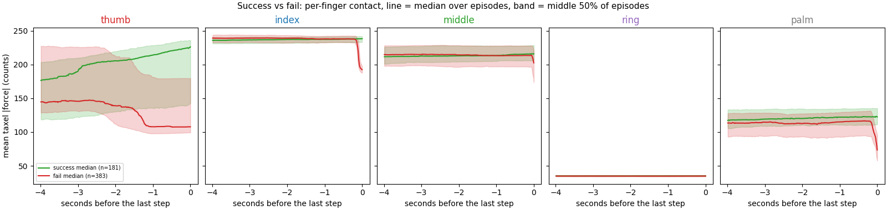
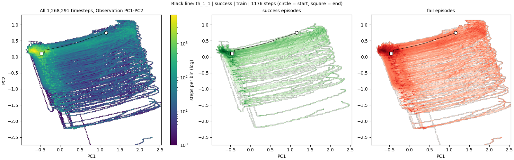

# 3. Tour of the data explorer

```bash
./eval/mechanical_pen/run_visualize_data.sh      # then open http://localhost:7861
```

The explorer has six tabs. Work through them in order the first time.

---

## Tab 1: Overview

**The text table.** This is the inventory: how many episodes, how many succeed, the train/val split, and the source groups. Read the bullet points under it. They are automatic sanity checks:

- reward is non-zero only on the last step,
- success episodes are terminal and fail episodes are truncated,
- there are no NaN or inf values.

If you regenerate the data and one of these changes, something in the pipeline changed.



**Left: how long are the episodes?** A histogram of episode lengths, with green for success and red for fail. The two colours barely overlap:

- 90% of successes take 15–22 s (median 18.4 s),
- 90% of fails take 20–27 s (median 24.7 s).

Fails are recordings that ran until the operator or the timeout gave up. **Episode length alone almost predicts the outcome.** The world model never sees the episode length, so it can't cheat with it directly. Still, it's worth knowing (chapter 6).

**Middle: one dot per episode.** The x-axis is length; the y-axis is the strongest single-taxel force in the episode. Black circles are the val episodes. Look for:

- **outliers**: dots far from the cloud, such as the fail episode near 8,300 counts. Open them in the Episode tab and check whether they are real or a sensor glitch;
- **whether val looks like train**. It should be spread across the same cloud.

**Right: average contact per finger.** These are violin plots. A violin is a histogram turned on its side and mirrored, with a bar at the median. Each violin summarises one number per episode: that finger's mean |F| over the episode. Read it like this:

- **Index and middle** carry the most force. They hold the pen.
- **Ring** sits at about 33 counts in every episode. It never touches anything; that's the sensor's resting level, not contact.
- **Thumb** is the only finger where success (median 167) and fail (median 124) clearly differ. That makes sense: the thumb is what clicks.

**The table** at the bottom lists every episode. Click a column header to sort, for example by `max |F|` to find the extreme episodes.

---

## Tab 2: Episode

This tab replays one episode. Choose it in the dropdown. The label shows the source name, the outcome, the split and the length.



**The hand at this step (top image).** Each dot is one taxel, placed where it is in space and coloured by how hard it is pressed (bright = hard).

- **Front view (x, z)**: as if you face the palm. The fingers point up (+z); ring is on the left, index to the right of middle, thumb on the far right.
- **Side view (y, z)**: from the side. This shows how far each finger is curled towards the palm.
- **Top view (x, y)**: the projection the **model visualizer** uses. Fingers overlap in it, so get used to mapping between it and the front view.
- **Bars**: mean |F| of each patch at this step, coloured by finger.

**Colour scale.** "Fixed per episode" keeps the same colours for the whole episode, so you can see contact grow and shrink as you move the slider. "Rescale every step" stretches the colours to the current frame, which shows *where* the contact is even when it's weak.

Under the image, **Values at this step** lists:

- reward and flags,
- the strongest taxel,
- how many taxels are above 100 counts,
- all 16 actions, both scaled and converted back to radians.



**The whole episode (bottom image).** Every panel shares the same time axis, and the dotted line is the current step.

1. **Contact timeline**: one row per patch, time to the right, bright = pressed. You can read the whole story here: when the index and middle fingers close on the pen, and when the thumb comes in at the end.
2. **Contact per finger**: the same information summed per finger, as curves.
3. **Actions**: all 16 joint targets, coloured by finger. Line style tells joints apart within a finger. Flat lines are joints the operator didn't move. Notice that the ring (purple) and the `rot` joints barely move. Every line jumps at the very last step: that's the "last action = 0 rad" filler from chapter 1.
4. **Reward**: flat at 0 with a single spike at the end. Triangles mark `is_first`, `is_last` and `is_terminal`.

**The cyan band** (with "Show 64-step model window" ticked) marks 64 steps starting at the current step. That's the slice the model visualizer feeds the model when you set its *Window start* to that step. Use it to choose interesting windows before opening the model visualizer.

**Buttons.** Step ±10 and ±100, *Jump to strongest contact*, and *Jump to last step*.

> Tip: to see a failed ending, pick a `fail` episode and press *Jump to last step*. In about 9 of 10 fail episodes, the actions move and the index/palm forces drop in the last 0.1–0.2 s. That is the hand starting to let go **before** the recording stops. Chapter 6 explains why it matters.



---

## Tab 3: Tactile stats



The top row follows one force value through the three steps the model applies before using it:

1. **Raw `forces_local`** in counts, as stored on disk. A sharp peak near 0 with very long tails out to ±1,500 and beyond; the y-axis is logarithmic, so those tails are rare. The z axis (blue) is lopsided: pressing *into* a taxel gives large positive z, and nothing pulls it strongly negative.
2. **After the z-score**: the same shape, now measured in standard deviations. The bulk sits within ±1, and the tails reach past ±10σ.
3. **After symlog**: what the encoder sees. The tails are folded in to about ±3, and the yellow band is where symlog is nearly linear (|z| < 1), which holds 87.8% of the values. That's the regime you want: small and ordinary forces are kept in proportion, and only extreme spikes get compressed.

The bottom row:

- **Positions per axis.** The spiky comb shape is *not* noise. Taxels sit at fixed places on rigid links, so each spike is a group of taxels at about the same coordinate. Positions are in metres and not normalised.
- **How much does each signal move?** For each episode, the average over time of the per-dimension variance. Forces (after z-score and symlog) vary about **200× more** than positions (in metres). The model's loss adds the errors of both. So it can nearly ignore positions and still get a small position loss. A small `positions` loss is therefore not proof that the model tracks the fingers.
- **How often is each taxel pressed?** Taxels sorted from busiest to quietest, for three thresholds:
  - 312 taxels exceed 100 counts at least once,
  - only 76 ever exceed 1,000.

  Most of the skin is rarely or never used in this task.

**The numbers box** checks the statistics against the config:

- the force mean/std match `forces_norm` exactly,
- no taxel reads exactly 0 (the outlier-removal step left no gaps),
- positions move a median 0.022 mm per step.

**Which taxels get touched?** This panel has a threshold slider.



- **Left**: the share of time each taxel is above the threshold, drawn on the hand. The pen is held by the index finger's `link2` and `link1A`, the middle finger's `link5A` and the thumb's `link15`; each is above 100 counts about 90% of the time or more (`middle link6` about 75%). The ring finger is dark.
- **Middle**: the typical (median) |F| of each taxel, on a log colour scale. This is the "resting level" from chapter 1. Untouched taxels still read tens of counts.
- **Right**: the same activity averaged per patch.

Move the threshold from 100 to 1,000 and watch which taxels still light up. Those are the real hard contacts.

---

## Tab 4: Actions



The tab shows 16 small histograms, one per joint, over every timestep. The dotted line is 0 rad (open pose).

- **Ring finger (purple)**: a single spike. The ring finger never moves, and its four actions are constants.
- **`if_rot`, `mf_rot`**: almost constant too.
- **Several separate spikes** (as in `if_mcp` and `mf_mcp`) mean the operator held the joint at a few preferred angles.
- **Index and middle `pip`**: pushed towards the top of the range, the curled grip around the pen.

**The correlation matrix** (bottom right) has red blocks among `if_mcp`, `if_pip`, `mf_mcp` and `mf_pip`: the index and middle fingers close together. The thumb's `th_cmc` and `th_axl` are also linked. The ring finger's correlations are meaningless, because a constant has no variation to correlate.



**How smoothly do the actions change?**

- **Bars**: the percentage of steps where the action does not change at all. It's 85–95% for most joints and 100% for the ring. Commands arrive less often than the 100 Hz sample rate, and each one is held until the next.
- **Dots**: the size of the larger changes, as the 99th percentile of |change per step|.

So the model sees step-like actions, not smooth curves.

---

## Tab 5: Success vs fail



There is one plot per finger. All episodes are aligned at their last step (x = 0), the line is the median across episodes, and the band holds the middle 50%.

- **Thumb**: in successful episodes, force rises steadily over the last 2–3 s; that is the thumb pressing the button. In failed ones it stays low and *drops* about 1.5 s before the end.
- **Index, middle and palm**: identical for success and fail, until the **last ~0.15 s** of the fail episodes, where they suddenly drop. That's the hand releasing before the recording ends.
- **Ring**: a flat line at its resting level.

Switch to **Start of episode**. The curves for success and fail overlap: every episode starts the same way, and the difference only appears at the end.

---

## Tab 6: Coverage map

Press **Draw**. The first time it can take a few minutes if the shared cache is missing; afterwards it takes about a second. This is the same PCA embedding the model visualizer uses for its density panel.



- **Left**: all 1.27 million timesteps on the PC1–PC2 map, coloured by log count. The bright blob on the left is where most time is spent (holding the pen). Each episode is a path through this map.
- **Middle and right**: the same map split by outcome (or by train/val, using the radio button). If one group covers a region the other never visits, the model has little data on that group's behaviour there.
- **Draw one episode on top**: the black line is one episode's path, from a circle (start) to a square (end). On the Observation map, episodes start on the right (high PC1, the hand still open) and travel left as the fingers close on the pen.

Feature spaces:

- **Observation**: forces and positions combined, which is what the model's encoder sees.
- **Forces** or **Positions** alone.
- **Action**: what the operator commanded.

Coverage in **Action** space tells you which commands the model has seen. If LEQ later proposes actions outside the cloud, the world model is guessing.

When the split is **Train / val**, the val episodes should sit inside the train cloud. If they do, val errors in the model visualizer measure generalisation to *new episodes of the same behaviour*, not to new behaviour.
