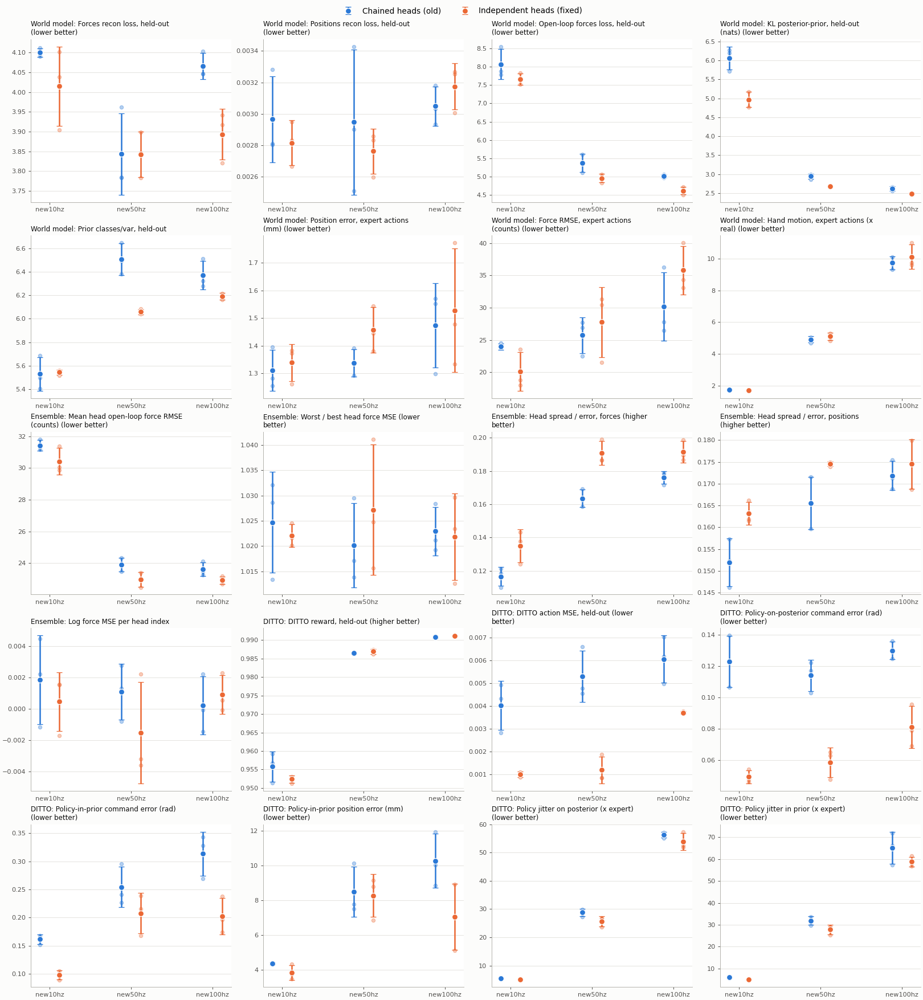

# Independent ensemble prior heads: does the fix help?

**Short answer: yes, mostly for the policy.** With the fix, DITTO's commands are 38–60%
closer to the demonstrator's at every rate, well outside the seed spread. The world model
improves a little (lower KL, better open-loop forces). Jitter improves only slightly, and
the data rate is still what decides how jerky the policy is. 10 Hz is still the best rate.

## What changed

[PossibleBug.md](../../PossibleBug.md) describes the bug: in `RSSM._prior`
([dreamerv3/nets.py](../../../../dreamerv3/nets.py)), the 7 ensemble prior heads were
chained. Head `j` read head `j-1`'s last hidden layer instead of the GRU feature, so the 7
heads formed one 14-layer network. The fix gives every head the same input (`feat`).

- It is behind the flag `dyn.rssm.independent_heads`. The flag defaults to `False`, so old
  checkpoints still load.
- `train_ditto.sh` and `train_leq.sh` copy the flag from the world model's `config.yaml`.
- Checked in the checkpoints: with the fix, every head's first layer `img0_j` is 2048 → 256
  (reads `feat`). In the old models, heads 1–6 are 256 → 256 (read the previous head).

## Setup

| | Chained (old) | Independent (fixed) |
|---|---|---|
| Runs | `logdir/data_sweep` (2026-11-11) | `logdir/data_sweep_indep` (2026-11-12) |
| Flag | `independent_heads: False` | `independent_heads: True` |

Everything else is the same in both: data, held-out split, rollout episodes, 50k world-model
steps, 50k DITTO steps, and every config value apart from the flag (checked by diffing the
configs). No code changed between the two sweeps apart from this fix.

- Data: sparsh-skin run at each rate on the real mechanical pen demos: `new10hz`,
  `new50hz` and `new100hz`. Synthetic data is not used.
- Seeds 0, 1 and 2 per rate, so 9 runs on each side.
- Each run: world model, then DITTO on that world model, then 3 held-out successes
  rolled out from 0.8 s (`rollout_leq_wm.sh`).
- Ensemble metrics come from [ensemble_heads_eval.py](../../ensemble_heads_eval.py):
  - 56 held-out episodes, 4 windows each.
  - Each window: 8 steps observed, then 56 steps imagined with the expert's actions, once per head.

**How to read the verdicts.** Values are mean ± standard deviation over the 3 seeds. A
change is only called *better* or *worse* if the means differ by more than the two
standard deviations added together. Otherwise it is *within seed spread*, which means it
could be chance.

## Headline results

| | 10 Hz | 50 Hz | 100 Hz |
|---|---|---|---|
| **Policy-on-posterior command error (rad)**, as on the hand | 0.123 → **0.049** (−60%) | 0.114 → **0.059** (−49%) | 0.130 → **0.081** (−38%) |
| **DITTO action MSE, held-out** | 0.0040 → **0.0010** (−75%) | 0.0053 → **0.0012** (−78%) | 0.0061 → **0.0037** (−39%) |
| Policy-in-prior command error (rad) | 0.161 → **0.098** (−39%) | 0.255 → 0.208 (−18%, noise) | 0.314 → **0.203** (−35%) |
| Policy jitter on posterior (x expert) | 5.52 → **5.08** (−8%) | 28.8 → **25.7** (−11%) | 56.4 → 53.9 (−4%, noise) |
| Policy jitter in prior (x expert) | 5.90 → **5.00** (−15%) | 31.9 → 27.9 (−13%, noise) | 65.2 → 58.8 (−10%, noise) |
| World-model KL, held-out (nats) | 6.07 → **4.97** (−18%) | 2.95 → **2.67** (−9%) | 2.62 → **2.49** (−5%) |
| Open-loop forces loss, held-out | 8.07 → 7.67 (−5%, noise) | 5.37 → **4.96** (−8%) | 5.01 → **4.61** (−8%) |
| Heads' spread / error, forces | 0.117 → **0.135** | 0.163 → **0.191** | 0.176 → **0.192** |
| DITTO reward, held-out | 0.956 → 0.952 (noise) | 0.986 → 0.987 (noise) | 0.991 → 0.991 (noise) |

Bold = the change is larger than the seed spread. Full tables per rate:
[comparison.md](comparison.md) and [comparison.csv](comparison.csv).



## What it means

1. **The policy is much more accurate.** The command error with real sensor input is
   what matters on the hand, and it falls by 38–60%. Every seed of the fixed runs beats
   every seed of the old runs at all three rates. DITTO's held-out action MSE falls by
   the same amount.

   A likely reason: DITTO trains in imagination, and each imagined step uses a random
   head. With the chained heads, the heads were networks of different depth (2 to 14
   layers). The imagined latents the policy learned from were therefore less consistent
   from step to step. This explanation was not tested directly.

2. **Jitter improves a little but is not solved.** At 10 and 50 Hz, the policy is 8–15%
   less jerky. At 100 Hz the change is within the seed spread. The rate still dominates:
   the policy is about 5× as jerky as the expert at 10 Hz, 26× at 50 Hz and 54× at 100 Hz,
   with or without the fix. The fix does not change which rate to use.

3. **The world model is slightly better.**
   - Better: held-out KL is lower at every rate, and open-loop forces loss is lower at
     50 and 100 Hz.
   - Steadier: the prior's certainty (prior classes/var) varies less between seeds.
     Its seed std drops from 0.12–0.14 to 0.02–0.03.
   - No clear change: reconstruction is about the same. Expert-action rollout error
     (position, force RMSE) shows no change beyond the seed spread, and only 3 episodes
     are rolled out per run.

4. **The heads now disagree more, as predicted, but still far too little.** The heads'
   spread relative to their error rose 9–17% for forces, so the bug did make the
   ensemble a little overconfident. But the spread is still only 0.13–0.19 of the
   actual error. The ensemble underestimates its own error about 5× either way. This
   matters for LEQ's uncertainty penalty. The chained heads were not the main cause.

5. **No drift by head position.** The bug note guessed that later, deeper heads would
   drift more. In both versions the worst head's MSE is only 1.02–1.03× the best head's,
   and the error does not rise with head index. That guess is not supported.

6. **DITTO reward cannot tell the two apart.** It is close to saturated
   (0.95–0.99) in both versions, so it is not a useful metric here.

## Caveats

- Only 3 seeds per side, so the overlap rule is a rough guide, not a significance test.
- Rollout metrics (command error, jitter, position error) come from 3 held-out episodes
  per run, the same episodes in both versions.
- The two sweeps ran a day apart on the same machine with the same code. The only change
  was the fix.

## Recommendation

- Use `--dyn.rssm.independent_heads True` for every new mechanical-pen world model.
- Consider making it the default in the `mechanical_pen:` config block. Old checkpoints
  will still load, because the rollout and visualizer scripts read each run's own
  `config.yaml`, and the training scripts copy the flag from the checkpoint.

## Reproduce

```bash
DV3=/workspace/LeapXELA_Hardware_ws/ros_ws/demonstrations/compose_playbacks/DV3
DATASETS="new10hz=$DV3/10hz new50hz=$DV3/50hz new100hz=$DV3/100hz" SEEDS="0 1 2" \
  GPUS="0 1" WM_FLAGS="--dyn.rssm.independent_heads True" RUN_TAG=indep \
  SWEEP_DIR=logdir/data_sweep_indep ./eval/mechanical_pen/run_sweep_data.sh
python3 eval/mechanical_pen/ensemble_heads_eval.py \
  --models logdir/data_sweep{,_indep}/seed{0,1,2}/new{10,50,100}hz/model
python3 eval/mechanical_pen/heads_fix_compare.py --baseline logdir/data_sweep \
  --fixed logdir/data_sweep_indep --labels new10hz new50hz new100hz \
  --out eval/mechanical_pen/reports/independent_heads
```

Runtime: about 4.5 h for the 9 runs on two RTX 4090s, plus about 30 min for the ensemble metrics.
